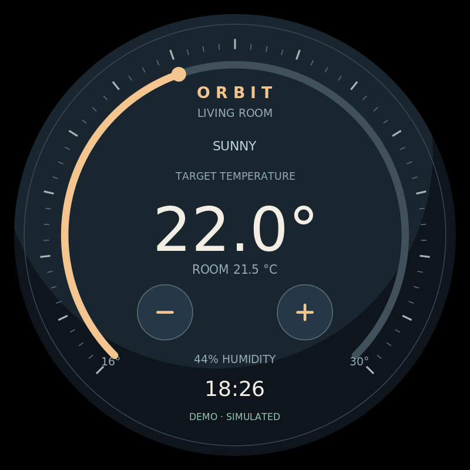

# Orbit：原生Python圆形触摸看板

**v0.3.0**采用Python + GTK/Cairo直接画界面，和屏幕触摸测试使用同一类技术。标准入口不需要浏览器、WebKit、网页服务器、pip、Node或虚拟环境。它不依赖pi-setting，系统显示和触摸状态正确即可。


[English](README.md) · [复制到Pi并通过SSH运行](docs/raspberry-pi-ssh.md) · [标准命令详情](docs/standard-app.md) · [验证记录](docs/verification.md) · [版本记录](CHANGELOG.md)

## 在已配置的圆形触摸屏运行

在树莓派项目目录，用普通桌面用户执行：

```bash
./setup.sh --install-only
./app --version
./app check --port 2 --shape round --panels 1 --input touch
./app start --port 2 --shape round --panels 1 --input touch --data-source demo
./app status --port 2
./app logs --port 2 --follow
./app stop --port 2
```

port1=HDMI-A-1（Pi4板子HDMI0），port2=HDMI-A-2（板子HDMI1）。以上用接口2，接接口1时统一换成1。日志跟随按Ctrl+C只退出查看，应用继续运行。

依赖只有发行版Python、GTK3/Cairo绑定、GTK layer-shell和wlr-randr。安装脚本检查缺失包；依赖已有时不联网下载。默认只安装，不再自动打开浏览器。SSH启动会发现当前用户唯一的Wayland桌面；该用户须已登录桌面。不是ssh -X，也不要求猜DISPLAY。

运行目标为Raspberry Pi OS Bookworm桌面/labwc、方形画布至少360×360、100%缩放、不旋转。应用不更改分辨率、像素时钟、刷新率或USB映射，不支持双屏画布和其他形状。可选screen-test可以辅助检查，但不是依赖。

## 画面和触摸

显示目标温度、室温、湿度、天气和时钟。点−/+每次调整0.5°C，或沿刻度环拖动；范围16～30°C。点击文字不改温度，第二根手指不能接管当前手势，取消/移出按钮后抬手不提交。

原生touch与鼠标模拟触摸都支持，并避免重复提交。状态包含touch_events/pointer_events和target；计数只证明事件到达，坐标仍要物理核对。触摸只负责操作应用，不自动校准系统。

**本次800×800、60Hz、接口2的圆形触摸屏已实测：**系统确认窗口位置，用户确认画面完整、按钮与旋钮正常；原生触摸事件已记录。其他SKU/尺寸、真实HA和长期稳定性未据此自动认证。详情见验证记录。

## 模拟与真实数据

demo在单个Python场景进程内生成数据，不启动HTTP服务器，也不读取遗留HA_*变量。后端仅在显式live时访问HA；后台线程处理数据和写入，不阻塞触摸绘图。

```bash
mkdir -p ~/.config/orbit
cp examples/homeassistant.json ~/.config/orbit/config.json
nano ~/.config/orbit/config.json
nano ~/.config/orbit/ha-token
chmod 600 ~/.config/orbit/ha-token
./app stop --port 2
./app start --port 2 --shape round --panels 1 --input touch --data-source live --config ~/.config/orbit/config.json
```

在自己的JSON中填写HA地址/实体，在ha-token中只填令牌。token_file相对配置目录，令牌不放命令参数或日志。HA系统和实体使用摄氏度，支持单温度climate.set_temperature；范围/步长和TLS检查保留。离线/写入失败明确反馈，不自动切回模拟。真实设备接收请求不等于动作已完成。

## 代码与旧版本

```text
app / screen-app.json     标准命令与精确能力声明
orbit_app/
  cli.py / runtime.py     命令、后台监督、实例归属
  display.py              读取输出、绑定指定HDMI
  worker.py               GTK窗口和事件/数据生命周期
  drawing.py / touch.py   Cairo绘制、共用坐标和触摸状态
  backend.py / config.py  标准库HA数据、私有配置
examples/                 无秘密的配置模板
tests/                    命令、后端、运行管理和原生手势检查
```

原有ui/、server.py、Chromium脚本仅保留为旧网页预览/兼容路径，./app不使用它们。需要旧浏览器依赖时明确运行./setup.sh --legacy-browser；不会默认下载。

若旧round-display-kiosk.service仍运行，先用./scripts/install_service.sh --uninstall迁移；本版不自动创建开机启动，后台start只保证桌面会话期间运行。

开发检查：python3 -m unittest discover -s tests -v。原生绘图需Cairo，实际窗口需目标Pi的GTK/Wayland。旧browser_smoke检查只针对保留网页，不是本版原生界面验收。
