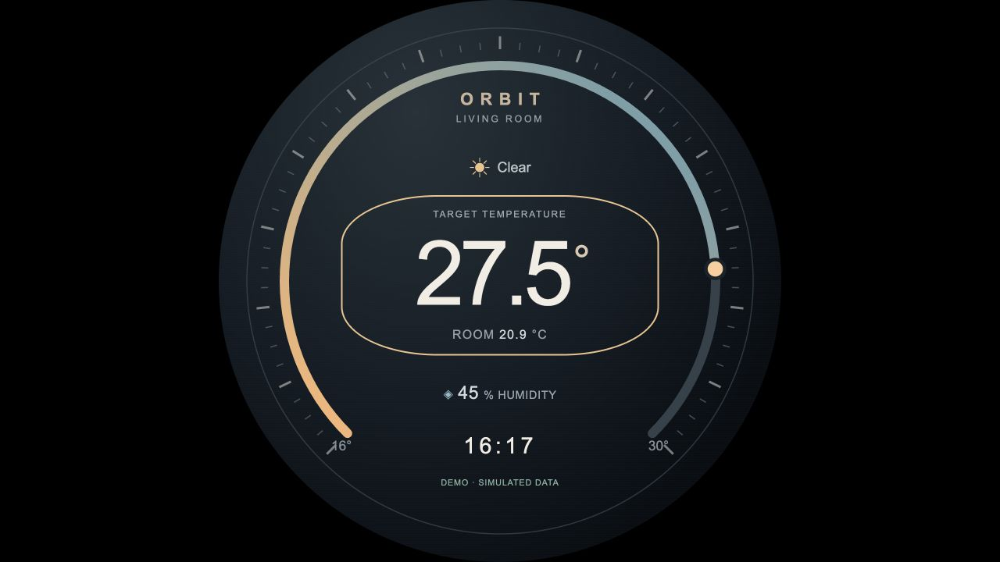

# Orbit——圆屏 Home Assistant 自助仪表盘

  

[English](README.md)

一款带暖金属质感刻度环的圆形温控界面，显示温度、湿度、本地时钟和天气，支持触摸/键盘调节旋钮设定值。所有内容裁剪到圆形可视区域内，可用于 480×480 和 720×720 屏幕，无外部字体、框架或云端素材。模拟数据有明确标记；可选的 Home Assistant REST 集成由仅监听本机的 Python 适配器处理，令牌不会进入浏览器 JavaScript。



## 文件结构

```text
round-screen-homeassistant-kiosk/
├── docs/
│   └── preview.png
├── scripts/
│   ├── install_service.py
│   ├── install_service.sh
│   ├── start_kiosk.sh
│   └── start_session.sh
├── tests/
│   └── test_server.py
├── ui/
│   ├── app.js
│   ├── index.html
│   └── style.css
├── .gitignore
├── README.md
├── README_CN.md
├── server.py
└── setup.sh
```

## 接线与快速启动

先断电，将树莓派 HDMI0（Pi 4/5 为 micro-HDMI）接到驱动板 HDMI 输入。按标签要求为树莓派和驱动板供电，用 USB 数据线连接驱动板的 USB HID 触摸/数据接口。参考配套硬件指南，将桌面设置为屏幕原生 480×480 或 720×720，缩放为 100%。需要 Raspberry Pi OS Bookworm/Bullseye 桌面版，或已配置 Chromium 与 Wayland/X11 会话的 Debian。

```bash
chmod +x setup.sh scripts/*.sh scripts/*.py
./setup.sh                    # Installs APT dependencies and opens the demo
./setup.sh --install-only     # Install without launching
./scripts/start_kiosk.sh      # Later launches
```

不需要 pip 包或虚拟环境，服务器仅使用 Python 标准库。Chromium 以桌面用户运行并保留沙箱。Wayland 使用原生 Ozone 后端，X11 使用自身后端和 `unclutter`。内置界面通过 CSS 在两种环境中隐藏鼠标；外部 HA 页面在 Wayland 下可能需要配置合成器的鼠标隐藏功能。Kiosk 是展示模式，并非操作系统访问控制边界，可通过 Alt+F4 或桌面窗口操作退出。

任意具备 Python 3.9+ 的开发机都可预览：

```bash
python3 server.py --port 8765
# Open http://127.0.0.1:8765/ in a browser. Do not open index.html as file://.
```

## 旋钮与 API 行为

沿刻度环拖动，以 0.5 °C 步进设置 16–30 °C。聚焦滑块后可使用方向键、Home 和 End。浏览器每 10 秒读取遥测，每秒更新时钟，对写入做防抖，并显示离线/写入失败状态。离线时保留上次遥测。界面明确使用摄氏度，华氏度实体会被拒绝，避免标错单位。模拟设定值仅保存在内存中，服务器重启后恢复为 22 °C；时钟遵循树莓派区域与时区，因此应先配置时间同步。

| 接口 | 行为 |
| --- | --- |
| `GET /api/state` | 返回 JSON：`temperature`、`humidity`、`target`、`weather`、`mode`（`demo` 或 `homeassistant`） |
| `POST /api/setpoint` | 接收 JSON `{"target":22.5}`，返回接受的 `target` 和 `mode` |

```bash
curl http://127.0.0.1:8765/api/state
curl -X POST http://127.0.0.1:8765/api/setpoint \
  -H 'Content-Type: application/json' -d '{"target":22.5}'
```

服务器**仅绑定 127.0.0.1**，检查 Host/Origin，设置禁止缓存的响应头，限制写入请求体大小，并拒绝浏览器跨源写入。界面不会接收到 HA 令牌或原始 HA 数据。不要通过公网端口转发暴露此轻量适配器。接入其他系统时，实现 `Backend.state()` 与 `Backend.setpoint()`，保持相同归一化协议即可。本项目以 REST 适配器作为集成接口，不实现 WebSocket 端点。

## 将内置界面接入 Home Assistant

为权限适当受限的 HA 用户创建长期访问令牌。选择数值型摄氏度温度传感器、百分比湿度传感器、单设定值摄氏度 `climate` 实体和天气实体。温控实体必须支持 `climate.set_temperature`。温度为 unavailable/unknown 时会明确返回 API 错误。写入前会检查实体的 `min_temp`、`max_temp` 和 `target_temp_step`；如需超过 16–30 °C，应同时调整前后端常量。冷暖双设定值实体需要修改适配器。

临时本机启动时，在 shell 中导出 `HA_URL`、`HA_TOKEN`、`HA_TEMP_ENTITY`、`HA_HUMIDITY_ENTITY`、`HA_CLIMATE_ENTITY`、`HA_WEATHER_ENTITY` 后再启动。持久配置时，先安装下面的服务，再编辑权限为 0600 的私有环境文件。文件使用 **systemd EnvironmentFile 语法**，不是 shell 的 `export` 语句。各项应填写真实 HA 地址、令牌和实体 ID。默认实体为 `sensor.living_room_temperature`、`sensor.living_room_humidity`、`climate.living_room`、`weather.home`。`HA_URL` 与 `HA_TOKEN` 必须同时设置；都不设置时启用模拟模式。不要将令牌提交到 Git 或放入截图。

服务器携带 Bearer 令牌读取 `/api/states/{entity_id}`，向 `/api/services/climate/set_temperature` 发送 `entity_id` 和 `temperature`。请求有超时限制，拒绝重定向并验证 HTTPS 证书。请配置有效的本地 CA 证书，不要关闭 TLS 验证。服务调用成功代表 HA 已接收请求，不代表物理加热已经完成；后续轮询读取实体的权威设定值。适配器不会绕过 HA 权限，也不自行认证用户。

## 直接显示已有 Lovelace 仪表盘

将 `KIOSK_URL` 设置为 HA 仪表盘地址，例如 `https://homeassistant.local:8123/lovelace/climate` 后启动。此方式显示完整 HA 前端，不使用本地界面和服务器。Chromium 必须能够解析主机名并信任 TLS 证书，登录在 HA 页面内完成。默认 Chromium 配置目录是临时目录，退出后删除，因此 HA 登录**不会跨重启保留**；如有需要，应另行管理持久浏览器会话。不要把长期令牌放入 URL，也不要关闭 HA 认证。

Home Assistant Cast 属于另一条路径：Lovelace Cast 面向支持 Cast 的接收设备，并要求符合 HA 支持的 HTTPS/网络配置。本项目在树莓派本机运行 Chromium，脚本不会把树莓派变成 Google Cast 接收器。这里支持的树莓派方案是直接打开 Lovelace URL。

## 通过 systemd 开机进入仪表盘

使用 `sudo raspi-config` → System Options → Boot / Auto Login → Desktop Autologin 配置**桌面自动登录**，不同版本菜单名称可能不同。仅控制台自动登录不会启动合成器。然后以桌面用户运行，**不要加 sudo**：

```bash
./scripts/install_service.sh
# Edit ~/.config/round-display-kiosk/environment if using HA or KIOSK_URL.
systemctl --user restart round-display-kiosk.service
systemctl --user status round-display-kiosk.service
journalctl --user -u round-display-kiosk.service -b
```

安装器在 `$XDG_CONFIG_HOME/systemd/user`（默认 `~/.config/systemd/user`）写入用户服务，并创建 XDG 桌面自启动项。登录后，`start_session.sh` 导入真实的 DISPLAY/WAYLAND_DISPLAY 等会话环境，再启动服务，避免猜测 `wayland-0` 或在合成器就绪前打开浏览器。服务会延迟重启退出或失败的 kiosk 进程，并设有频率限制。它由桌面自启动触发，不依赖 `systemctl enable` 或 user lingering。仓库必须保留在安装时的绝对路径，移动后重新运行安装器。

桌面必须支持 XDG 自启动。Raspberry Pi OS 会话通常支持；如果自行精简的 labwc/Wayfire 会话不支持，应将 `scripts/start_session.sh` 的绝对路径加入合成器自启动，并**取代** XDG 项，避免重复执行。用户服务仍需要正常的用户 systemd/DBus 会话。如需完整家电式外观，请在桌面设置中配置屏幕空白、空闲和锁屏策略；脚本不全局修改电源管理。

```bash
./scripts/install_service.sh --uninstall
```

卸载会停止服务并删除 unit/自启动项，保留环境文件。桌面自动登录仍是系统设置，可通过 raspi-config 取消。临时 Chromium 配置目录和极小缓存限制避免会话/缓存持久化，内置服务器响应还设置 `Cache-Control: no-store`。

## 显示边界与问题排查

内置界面是**单屏**仪表盘。双屏 HDMI 驱动板在系统中仍然是一个 SBS 宽输出，不会变成两个独立 DRM 显示器。如需两套仪表盘，应将页面扩展为 `2 × width` 乘 `height` 的容器，在两个独立裁剪的方形区域中分别渲染。本仓库不会自动将单圆界面复制到两个半区。

| 问题 | 检查项目 |
| --- | --- |
| 浏览器黑屏或无视频设备 | 图形桌面是否活动、HDMI 模式、原生缩放、用户/会话权限；不要用 sudo 启动 Chromium。 |
| 手动启动正常，开机不启动 | 桌面自动登录、XDG/合成器自启动、用户日志；`start_session.sh` 必须在合成器启动后执行。 |
| 离线或 HA 错误 | HA 基础地址、令牌权限、真实实体 ID、摄氏度单位、有效 TLS 和实体可用性；故障不会悄悄切回模拟模式。 |
| 设定值被拒绝 | 16–30 °C、0.5 步进、实体范围/步长及 HA 服务支持。 |
| 端口占用 | 停止其他服务器，或把 `KIOSK_PORT` 改为未占用的 1024–65535 端口。 |
| 外部页面仍有鼠标 | 内置 CSS 无法影响其他源；使用 X11 unclutter 或 Wayland 合成器鼠标设置。 |
| 界面被裁掉 | 原生方形分辨率、无过扫描、100% 缩放；圆形遮罩会有意隐藏四角。 |

## 验证范围

本机 API/模拟测试和浏览器预览可以验证软件行为。开机自启、触摸手势、GPU/合成器表现，以及真实 HA 设备操作，仍需在实际树莓派和网络中验证。

## 开发验证

```bash
python3 -m unittest discover -s tests -v
```

4 项标准库测试覆盖核心配置、行为或输入/API 边界。Home Assistant 请求通过本机 HTTP 测试服务验证，包含服务请求体、摄氏度校验、重定向拒绝和本地来源检查。开发验证在 macOS 上完成，并非树莓派硬件实测。已检查 Shell 语法和 Python 编译，并对适用的交互演示进行渲染。APT 安装及实际树莓派启动/桌面仍需实机检查。
